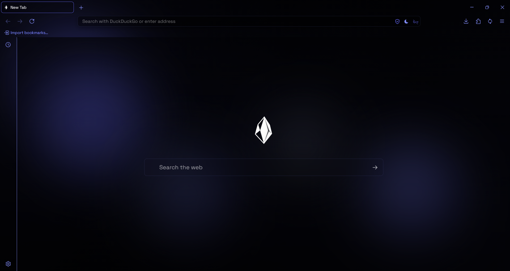

### `Obside Browser`

**A fast, private and secure way to explore the web.**

Obside is a privacy-focused, open-source browser built with the aim of delivering a faster, safer, and more private browsing experience.

<div>
  <a href="https://github.com/sl4de0day/obsidebrowser/releases/download/v150.1.0/obside-150.1.0.en-US.win64.installer.exe">Download</a>
  •
  <a href="https://obsidebrowser.com">Website</a>
  •
  <a href="https://obsidebrowser.com/docs">Documentation</a>
  •
  <a href="https://obsidebrowser.com/changelog">Changelog</a>
</div>

---

> [!WARNING]
> ## Project Status: Suspended
>
> **Development of Obside Browser has been suspended as of July 2026.**
>
> Active development, maintenance, technical support, and future updates are currently paused until further notice.
>
> The official website no longer provides downloads. However, the existing Windows installer remains available through GitHub Releases.
>
> Thank you to everyone who supported Obside Browser and showed interest in the project.

---

## **Screenshot**

<p align="center">
  
</p>

---

## **Features**

- **Privacy Protection** — Built-in ad and tracker blocking, fingerprinting protection, and a privacy-focused browsing experience.
- **Performance** — Optimized resource management, faster page loading, and reduced CPU and memory usage.
- **Security** — Built-in protection against malicious websites and phishing attempts.
- **Open Source** — Publicly accessible source code for transparency, inspection, and community contributions.
- **Firefox Extensions** — Support for compatible standard WebExtensions.
- **Automatic Updates** — Integrated update functionality.
- **Data Import** — Import bookmarks, passwords, and browsing history from other browsers.

---

## **Obside Premium**

Obside Premium was designed to extend the browser's privacy, security, and communication capabilities.

- **Advanced Download Security** — RAM-based protection and real-time malware scanning.
- **Premium E2EE Communication** — Enhanced video and audio communication with priority relays.
- **VPN Service** — Planned high-speed VPN infrastructure with unlimited bandwidth.
- **Unlimited File Transfer** — End-to-end encrypted file sharing without file-size restrictions.

*Premium services are not guaranteed to be operational while development is suspended.*

---

## **Build from Source**

Obside is based on Mozilla Firefox. Developers who want to build Obside themselves will need the Firefox source code and the Obside customization files.

**The Obside repository does not contain the complete Firefox source tree.** It contains project-specific files such as `assets`, `l10n`, `patches`, `scripts`, `settings`, and `themes/browser`. These files must be integrated into a compatible Firefox source checkout before building.

### **Requirements**

- 64-bit Windows 10 or later, or a supported 64-bit Linux distribution.
- Git and Python 3.
- MozillaBuild on Windows.
- At least 40 GB of free disk space on Windows or 30 GB on Linux.
- Additional disk space and sufficient memory are recommended for a full optimized build.

### **1. Obtain the Firefox Source Code**

Use Mozilla's official build environment and bootstrap process to download Firefox and its required dependencies.

**Windows**

1. Install [MozillaBuild](https://firefox-source-docs.mozilla.org/setup/windows_build.html).
2. Open the MozillaBuild shell.
3. Download and run Mozilla's bootstrap script:

```bash
cd /c/
mkdir mozilla-source
cd mozilla-source

wget https://raw.githubusercontent.com/mozilla-firefox/firefox/refs/heads/main/python/mozboot/bin/bootstrap.py

python3 bootstrap.py
```

Follow the interactive setup and select the Firefox Desktop build configuration.

**Linux**

Install the required basic dependencies:

```bash
sudo apt update
sudo apt install curl python3 python3-venv git make
```

Download and run the bootstrap script:

```bash
mkdir -p ~/mozilla-source
cd ~/mozilla-source

curl -LO https://raw.githubusercontent.com/mozilla-firefox/firefox/refs/heads/main/python/mozboot/bin/bootstrap.py

python3 bootstrap.py
```

Follow the interactive setup to download and configure the Firefox source code.

### **2. Obtain the Obside Repository**

Clone the Obside repository separately:

```bash
git clone https://github.com/sl4de0day/obsidebrowser.git
```

The repository contains the following project-specific directories:

| Directory | Purpose |
|---|---|
| `assets/` | Project assets |
| `l10n/` | Localization resources |
| `patches/` | Firefox source patches |
| `scripts/` | Build and development scripts |
| `settings/` | Project configuration |
| `themes/browser/` | Browser branding and themes |

Integrate the required Obside files into the corresponding locations in your Firefox source tree. Review the patch files and scripts before applying them, and follow any instructions included with those files.

> **Important:** Use a Firefox source revision compatible with the Obside release you are building. The latest Firefox source may not be compatible with older Obside patches or customizations.

### **3. Configure the Build**

Create a `.mozconfig` file in the root of your Firefox source directory.

Example configuration:

```bash
# Application
ac_add_options --enable-application=browser

# Obside branding
ac_add_options --with-branding=themes/browser/branding/obside

# Build directory
mk_add_options MOZ_OBJDIR=@TOPSRCDIR@/obj-obside

# Build optimizations
ac_add_options --enable-optimize
ac_add_options --disable-debug
ac_add_options --disable-tests
```

Adjust the configuration according to your environment and the Firefox source revision you are using.

### **4. Build Obside**

From the Firefox source directory, run:

```bash
./mach build
```

The first build can take a considerable amount of time depending on your hardware and available resources.

### **5. Run Your Build**

After a successful build, launch your locally built browser:

```bash
./mach run
```

The build output is generally located in:

```text
obj-obside/dist/bin/
```

### **Official Mozilla Documentation**

- [Building Firefox on Windows](https://firefox-source-docs.mozilla.org/setup/windows_build.html)
- [Building Firefox on Linux](https://firefox-source-docs.mozilla.org/setup/linux_build.html)
- [Firefox Build Configuration](https://firefox-source-docs.mozilla.org/setup/configuring_build_options.html)

---

## **Download**

Obside Browser is available for Windows (64-bit).

- [**Obside Browser v150.1.0**](https://github.com/sl4de0day/obsidebrowser/releases/download/v150.1.0/obside-150.1.0.en-US.win64.installer.exe) — Windows 64-bit Installer

Download the installer and follow the installation instructions.

> **Note:** This is an existing release. Since development is suspended, it may not include the latest security fixes.

---

## **Contributing**

Obside is an open-source project. Its source code is available on GitHub for anyone interested in exploring the project.

---

## **Contact**

For general inquiries:

- **Email:** [contact@obsidebrowser.com](mailto:contact@obsidebrowser.com)

For security vulnerabilities and responsible disclosure:

- **Security:** [security@obsidebrowser.com](mailto:security@obsidebrowser.com)

---

## **Social**

<p>
  <a href="https://x.com/obsidebrowser">
    
  </a>
  &nbsp;&nbsp;
  <a href="https://www.instagram.com/obsidebrowser">
    
  </a>
  &nbsp;&nbsp;
  <a href="https://www.reddit.com/user/ObsideBrowser/">
    
  </a>
</p>

---

## **License**

See the [LICENSE](LICENSE) file for licensing information.
